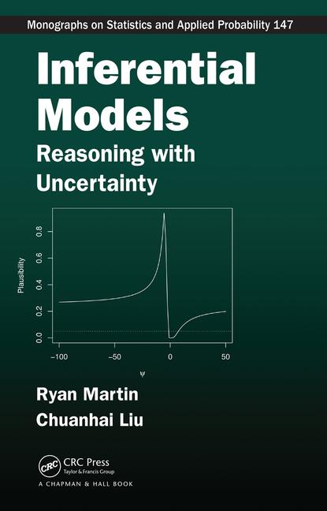

::::::: columns
:::: {.column width="30%"}

::::

:::: {.column width="10%"}
<!-- empty column to create gap -->
::::

:::: {.column width="60%"}

Inferential Models (IMs) were first introduced by [the 2015 book](https://doi.org/10.1201/b19269), as pictured to the left, by [Ryan Martin](https://martinrg07.github.io) and [Chuanhai Liu](https://www.stat.purdue.edu/people/faculty/chuanhai.html). 

:::{.callout-note appearance="simple"}
Inferential Models provide Bayesian style uncertainty quantification, both without the use of a prior, and with Type 1 error control guarantees at any sample size. 
:::

We argue that epistemic uncertainty (that a Bayesian posterior captures) is not best captured by probability, but rather through the language of *possibility*. 

This is because 
:::{.callout-warning}
Any probability distribution over a parameter space will necessarily put arbitrarily high weight on false hypotheses

cite.
:::

We contend that Frequentism and Bayesianism have philosophical flaws, and that the Inferential Model paradigm is one which holds great potential for the future of statistics.

::::
:::::::
